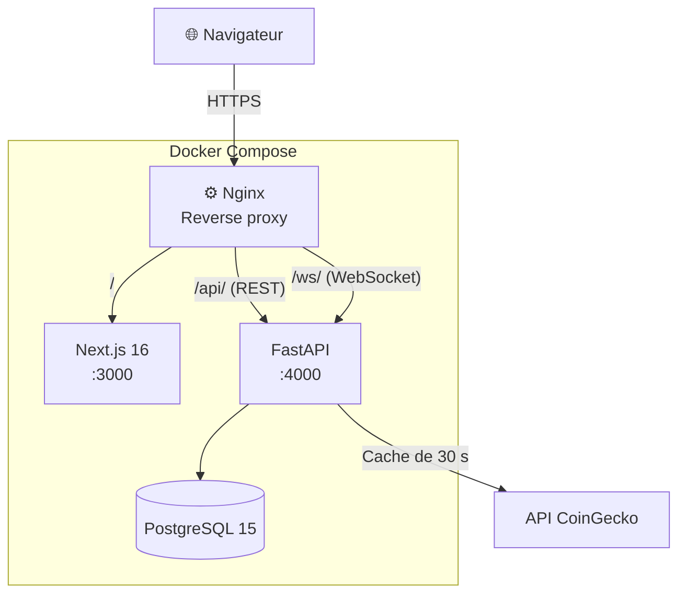

<div align="center">

# 🪙 Crypto-Explorer

**Marchés crypto en temps réel et simulation de portefeuille avec estimation des impôts par pays**

[crypto-explorer.fr](https://crypto-explorer.fr)

<br />

[](https://circleci.com)
[](https://nextjs.org)
[](https://fastapi.tiangolo.com)
[](https://www.postgresql.org)
[](https://docs.docker.com/compose)
[](https://www.typescriptlang.org)

</div>

---

## 📖 Présentation

**Crypto-Explorer** est une application web full-stack pour suivre les marchés des cryptomonnaies et s'entraîner à investir avec de l'argent fictif. Les données de marché viennent de l'API CoinGecko.

Le projet se compose d'un frontend Next.js et d'une API FastAPI, qui communiquent en REST et en WebSocket. Nginx les sert derrière un même domaine, et Docker Compose orchestre l'ensemble avec PostgreSQL.

---

## ✨ Fonctionnalités

| Module | Description | Accès |
|---|---|---|
| 🏠 **Accueil** | Page de présentation animée, aperçu du dashboard, section contact (lien e-mail) | Public |
| 📊 **Dashboard** | Prix actualisés par WebSocket toutes les 30 s, graphique en bougies ou en courbe (de 1 jour à 1 an), capitalisation, volume et dominance BTC, plus fortes hausses et baisses, recherche | Public |
| ⭐ **Favoris** | Cryptos suivies sur le dashboard, enregistrées dans le navigateur | Public |
| 🗺️ **Heatmap** | Carte du marché proportionnelle à la capitalisation, stablecoins masquables | Public |
| 💼 **Simulation bêta** | 10 000 € fictifs, sans frais ni impôt, enregistrés dans le navigateur | Sans compte |
| 📈 **Simulation complète** | Portefeuille enregistré en base, avec frais, impôts estimés et statistiques (voir ci-dessous) | Compte |
| 📰 **Blog** | Articles en base filtrables par catégorie, page par article (Markdown), articles recommandés | Public |
| 💬 **Blog : lecteurs** | Commentaires, j'aime, favoris (`/blog/favoris`) et sélection « Pour vous » | Compte |
| ✍️ **Rédaction** | Écrire, modifier, publier, dépublier et supprimer les articles, modérer les commentaires (`/redaction`) | Éditeur, Admin |
| 👥 **Équipe** | Attribuer les rôles lecteur, éditeur ou admin (`/redaction/equipe`) | Admin |
| 🔐 **Authentification** | Inscription et connexion par e-mail ou avec Google | Public |
| 👤 **Profil** | Consultation des informations du compte, déconnexion | Compte |
| ⚙️ **Paramètres** | Thème clair ou sombre, devise EUR ou USD, préférences de cookies | Compte |
| ⚖️ **Pages légales** | Mentions légales, politique de confidentialité, bannière de consentement | Public |

### Blog et rôles

Chaque compte a un rôle : **lecteur** (par défaut), **éditeur** ou **admin**. Les éditeurs et les admins gèrent tous les articles et peuvent supprimer n'importe quel commentaire ; seuls les admins attribuent les rôles. L'API vérifie le rôle en base à chaque requête : le rôle contenu dans le token ne sert qu'à afficher les bons menus.

- **Articles :** corps en Markdown (le HTML brut n'est jamais interprété), une catégorie parmi huit, brouillon ou publié. L'adresse `/blog/<slug>` est fixée à la création et ne change plus.
- **Pages publiques :** rendues par le serveur Next pour le référencement (métadonnées, données structurées `BlogPosting`), avec un cache d'une minute : un article publié apparaît sur le blog en moins de 60 s.
- **Recommandations :** même catégorie, catégories aimées ou mises en favori par le lecteur, popularité et fraîcheur ([`recommend.py`](backend/app/services/blog/recommend.py)).

Le premier admin se crée en ligne de commande, une fois son compte inscrit :

```bash
docker compose -f docker-compose-dev.yml exec backend python -m app.scripts.set_role vous@exemple.com admin
```

Il peut ensuite nommer les éditeurs depuis `/redaction/equipe`. Un changement de rôle s'applique tout de suite côté API ; les menus se mettent à jour au prochain chargement de page.

### Simulation complète

La page `/simulation` affiche la version bêta sans connexion et la version complète une fois connecté. Chaque utilisateur a un seul portefeuille.

- **Capital de départ :** de 1 000 à 50 000, en euros ou en dollars.
- **Pays de résidence :** France, Belgique, Suisse, Allemagne, Espagne, Italie, Royaume-Uni ou États-Unis. Il détermine l'impôt estimé et la devise proposée par défaut, et reste modifiable ensuite.
- **Ordres :** n'importe quelle crypto trouvée par la recherche, avec 0,1 % de frais par ordre. Le serveur fixe le prix d'exécution.
- **Suivi en direct :** valeur, gain ou perte, ROI, résultat après impôt estimé et positions, actualisés toutes les 30 s tant que l'onglet est visible.
- **Statistiques :** valeur dans le temps, baisse maximale (max drawdown), volatilité, taux de réussite, meilleure et pire vente, durée moyenne de détention, frais payés.
- **Historique :** export CSV des ordres et réinitialisation du portefeuille.

> L'impôt affiché est une estimation pour la simulation, pas un conseil fiscal. Les règles, leurs sources et leur date de vérification se trouvent dans [`tax_rules.py`](backend/app/services/simulation/tax_rules.py).

---

## 🏗️ Architecture



**Routage en production :**

| Chemin public | Destination |
|---|---|
| `/` | Frontend Next.js |
| `/api/*` | API FastAPI, préfixe `/api` retiré |
| `/ws/*` | WebSocket FastAPI, préfixe `/ws` retiré |

En local, le navigateur appelle directement l'API sur le port 4000.

**Fonctionnement du backend :**

- **Couches :** les `controllers` exposent les routes, les `services` portent la logique métier, les `repositories` accèdent à la base et les `clients` aux services externes.
- **Marché :** les réponses de CoinGecko sont gardées 30 s en mémoire. Tant qu'un client est connecté au WebSocket, l'API diffuse le top 20 toutes les 30 s.
- **Simulation :** seuls les ordres sont stockés. Les liquidités, les positions et les impôts sont recalculés à partir d'eux, avec des montants décimaux exacts. Une tâche de fond enregistre chaque heure la valeur du jour de chaque portefeuille.

---

## 🛠️ Stack technique

### Frontend

| Technologie | Rôle |
|---|---|
| **Next.js 16** + React 19 | Framework principal (App Router) |
| **TypeScript 5** | Typage statique |
| **Redux Toolkit** | État global |
| **Tailwind CSS v4** | Styles, avec le design system Nocturne ([`nocturne.css`](frontend/app/styles/nocturne.css)) |
| **lightweight-charts** | Graphiques de prix et de portefeuille |
| **anime.js** | Animations de l'accueil et de la connexion |
| **@react-oauth/google** | Connexion avec Google |
| **Plausible** | Mesure d'audience, chargée seulement après consentement |
| **Vitest** + Testing Library | Tests |

### Backend

| Technologie | Rôle |
|---|---|
| **FastAPI** + Uvicorn | API asynchrone REST et WebSocket |
| **SQLModel** + SQLAlchemy async | ORM |
| **asyncpg** / **aiosqlite** | Pilotes PostgreSQL / SQLite (tests et lancement sans Docker) |
| **Alembic** | Migrations de base de données |
| **python-jose** + **bcrypt** | Tokens JWT et hachage des mots de passe |
| **google-auth** | Vérification des connexions Google |
| **httpx** | Appels à CoinGecko |
| **aiosmtplib** | Envoi des e-mails de la route de contact |
| **pytest** + pytest-asyncio | Tests unitaires et d'intégration |

### Infrastructure

| Technologie | Rôle |
|---|---|
| **Docker** + Docker Compose | Conteneurisation |
| **Nginx** | Reverse proxy, HTTPS, en-têtes de sécurité, limites de débit |
| **PostgreSQL 15** | Base de données |
| **CircleCI** | Tests et déploiement |
| **SonarCloud** | Analyse de la qualité du code sur `dev` |
| **Let's Encrypt** | Certificats HTTPS |

---

## 📁 Structure du projet

```
Crypto_News/
├── frontend/                    # Application Next.js
│   ├── app/
│   │   ├── (landing)/           # Accueil et connexion
│   │   ├── (public)/            # Blog et pages légales
│   │   ├── (app)/               # Dashboard, heatmap, simulation, profil, paramètres
│   │   ├── components/          # Composants métier
│   │   ├── ui/                  # Composants d'interface réutilisables
│   │   ├── context/             # Thème, devise, consentement
│   │   ├── hooks/               # Hooks (useLogin, useRegistration…)
│   │   ├── lib/                 # Store Redux, appels API, auth, WebSocket, analytics
│   │   ├── providers/           # Providers de l'application
│   │   ├── styles/              # Design system Nocturne
│   │   ├── types/               # Types partagés
│   │   └── utils/               # Fonctions utilitaires
│   ├── __tests__/               # Tests Vitest
│   └── public/                  # Fichiers statiques
│
├── backend/                     # API FastAPI
│   ├── app/
│   │   ├── controllers/         # Routes (auth, markets, simulation, symbols…)
│   │   ├── services/            # Logique métier, dont simulation/ et email/
│   │   ├── repositories/        # Accès à la base de données
│   │   ├── clients/             # CoinGecko, Google
│   │   ├── models/              # Tables SQLModel
│   │   ├── schemas/             # Schémas Pydantic
│   │   ├── auth/                # Service de tokens JWT
│   │   ├── dependencies/        # Dépendances FastAPI (utilisateur connecté)
│   │   ├── core/                # Configuration
│   │   └── db/                  # Session de base de données
│   ├── alembic/                 # Migrations
│   └── tests/                   # Tests unit/ et integration/
│
├── nginx/
│   ├── nginx.conf               # Production
│   └── nginx.local.conf         # Développement
├── .circleci/                   # Pipeline CI/CD (config.yml, jobs/, env/)
├── docker-compose-dev.yml
├── docker-compose-prod.yml
└── sonar-project.properties
```

---

## 🚀 Installation

### Prérequis

- [Docker](https://www.docker.com/get-started) avec Docker Compose v2
- Ports libres : 80, 3000, 4000 et 5432

### 1. Cloner le dépôt

```bash
git clone https://github.com/Abdel1117/Crypto_News.git
cd Crypto_News
```

### 2. Créer les fichiers d'environnement

Les fichiers `.env` ne sont pas versionnés. Il en faut deux.

`.env` à la racine, pour Docker Compose et le backend :

```env
ENV=development

# Nginx attend ces deux ports : ne pas les changer sans adapter sa configuration.
PORT_FRONT=3000
PORT_BACK=4000

DB_HOST=db
DB_PORT=5432
DB_USER=postgres
DB_PASSWORD=change-me
DB_NAME=crypto_news

JWT_SECRET_KEY=change-me
JWT_ALGORITHM=HS256
JWT_EXPIRATION_MINUTES=15
JWT_REFRESH_EXPIRATION_DAYS=7

CORS_ORIGINS=http://localhost:3000,http://localhost

# Facultatifs
API_KEY_COINGECKO=
GOOGLE_CLIENT_ID=
```

`frontend/.env`, pour le frontend :

```env
NEXT_PUBLIC_API_BACK_END=http://localhost:4000
NEXT_PUBLIC_WS_BACK_END=ws://localhost:4000

# Facultatif
NEXT_PUBLIC_GOOGLE_CLIENT_ID=
```

> En local, garder l'API sur `http://localhost:4000`. Le cookie de session est lié au chemin `/auth` : en passant par `http://localhost/api`, le navigateur ne l'enverrait pas et la session ne pourrait pas être renouvelée.

### 3. Lancer le projet

```bash
docker compose -f docker-compose-dev.yml up --build
```

Au démarrage, le backend applique les migrations puis crée les tables manquantes : aucune commande supplémentaire n'est nécessaire.

| Service | URL |
|---|---|
| Application | http://localhost:3000 |
| Application via Nginx | http://localhost |
| API | http://localhost:4000 |
| Documentation de l'API (Swagger) | http://localhost:4000/docs |

### Variables d'environnement

| Variable | Fichier | Rôle |
|---|---|---|
| `ENV` | `.env` | `development` en local, exactement `production` sur le serveur. Seule cette valeur active le cookie `Secure` et le contrôle de `JWT_SECRET_KEY`. |
| `DB_*` | `.env` | Connexion à PostgreSQL. |
| `DATABASE_URL` | `.env` | Facultative. URL complète qui remplace les `DB_*`. |
| `JWT_*` | `.env` | Clé de signature et durées de vie des tokens. |
| `CORS_ORIGINS` | `.env` | Origines autorisées à appeler l'API, séparées par des virgules. |
| `API_KEY_COINGECKO` | `.env` | Facultative. Clé CoinGecko du plan Demo. Sans clé, l'API utilise le quota public, plus bas. |
| `GOOGLE_CLIENT_ID` | `.env` | Facultative. Identifiant OAuth Google. Sans lui, la connexion Google est indisponible. |
| `NEXT_PUBLIC_GOOGLE_CLIENT_ID` | `frontend/.env` | Facultative. Même valeur que `GOOGLE_CLIENT_ID`. |
| `SMTP_HOST`, `SMTP_PORT`, `SMTP_USER`, `SMTP_PASSWORD`, `SMTP_RECIPIENT` | `.env` | Facultatives. Serveur d'envoi et destinataire de `POST /contact/send`, une route que l'interface n'appelle pas pour l'instant. |
| `SIM_SNAPSHOT_INTERVAL` | `.env` | Facultative. Secondes entre deux enregistrements de la valeur des portefeuilles : 3600 par défaut, 0 pour désactiver. |
| `NEXT_PUBLIC_API_BACK_END` | `frontend/.env` | URL de l'API vue par le navigateur. |
| `API_INTERNAL_URL` | `docker-compose-*.yml` | URL de l'API vue par le serveur Next (pages du blog), déjà réglée sur `http://backend:${PORT_BACK}`. Sans Docker, `NEXT_PUBLIC_API_BACK_END` sert de valeur par défaut. |
| `NEXT_PUBLIC_WS_BACK_END` | `frontend/.env` | URL du WebSocket vue par le navigateur. |
| `NEXT_PUBLIC_APP_URL` | `frontend/.env` | Facultative. URL publique du site pour les métadonnées : `http://localhost:3000` par défaut. |
| `NEXT_PUBLIC_PLAUSIBLE_DOMAIN` | `frontend/.env` | Facultative. Domaine Plausible. Sans lui, aucune mesure d'audience. |

### Lancer sans Docker

Pour le backend, avec Python 3.11 ou plus récent :

```bash
cd backend
python -m venv .venv
source .venv/bin/activate        # Windows : .venv\Scripts\activate
pip install -r requirements.txt
alembic upgrade head
uvicorn app.main:app --reload --port 4000
```

Sans Docker, l'application ne lit pas le fichier `.env` : les variables doivent être définies dans le shell. Sans `DB_*` ni `DATABASE_URL`, l'API utilise une base SQLite dans `backend/app/data/database.db`.

Pour le frontend, avec Node.js 22 et le fichier `frontend/.env` décrit plus haut :

```bash
cd frontend
npm ci
npm run dev
```

---

## 🔌 API

La documentation complète est générée par Swagger sur http://localhost:4000/docs.

| Préfixe | Routes | Accès |
|---|---|---|
| `/auth` | `POST /register`, `/login`, `/google`, `/refresh`, `/logout` | Public |
| `/auth` | `GET /me` | Connecté |
| `/markets` | `GET` sur le préfixe, `GET /markets_view`, `/get_ohlc`, `/get_top_winners_losers`, `/coin`, `/exchange-rate` | Public |
| `/markets` | WebSocket `/ws` | Public |
| `/symbols` | `GET` sur le préfixe, `GET /search` | Public |
| `/trending` | `GET` sur le préfixe | Public |
| `/blog` | `GET /articles`, `/articles/{slug}`, `/articles/{id}/related`, `/articles/{id}/comments` | Public |
| `/blog` | `GET /articles/{id}/me`, `PUT/DELETE /articles/{id}/like` et `/favorite`, `POST /articles/{id}/comments`, `DELETE /comments/{id}`, `GET /favorites`, `/recommendations` | Connecté |
| `/blog` | `GET/POST /manage/articles`, `GET/PATCH/DELETE /manage/articles/{id}` | Éditeur, Admin |
| `/admin` | `GET /users`, `PATCH /users/{id}/role` | Admin |
| `/simulation` | `GET /countries` | Public |
| `/simulation` | `GET/POST/PATCH /portfolio`, `POST /portfolio/reset`, `GET /quotes`, `GET/POST /trades` | Connecté |
| `/contact` | `POST /send` | Public |

---

## 🧪 Tests et qualité

### Frontend

```bash
cd frontend
npm ci
npm test               # Mode watch
npm run coverage       # Une exécution, avec rapport de couverture
npm run type-check     # TypeScript
npm run lint           # ESLint
```

### Backend

```bash
cd backend
pip install -r requirements.txt
pytest tests           # Tests unitaires et d'intégration
pytest tests --cov     # Avec couverture
```

Les tests backend utilisent SQLite : ils ne demandent ni Docker ni PostgreSQL.

---

## 🔄 CI/CD

Chaque évolution part d'une branche créée depuis `dev`, y revient par pull request, puis `dev` est fusionnée dans `prod` pour déployer.

| Branche | Jobs CircleCI |
|---|---|
| Branches de travail | Tests frontend et backend |
| `dev` | Tests, puis analyse SonarCloud |
| `prod` | Tests, puis déploiement |

Le déploiement se connecte au VPS en SSH, récupère la branche `prod`, puis reconstruit et relance les conteneurs avec `docker-compose-prod.yml`.

Le fichier [`.circleci/config.yml`](.circleci/config.yml) assemble le pipeline à partir de `jobs/` et de `env/` selon la branche. L'option *Dynamic config* doit être activée dans les paramètres du projet CircleCI.

---

## 🔐 Sécurité

**Sessions**

- **Access token :** JWT de 15 minutes par défaut, gardé uniquement en mémoire côté client.
- **Refresh token :** JWT de 7 jours par défaut, renouvelé à chaque rafraîchissement, dans un cookie `HttpOnly`, `SameSite=Strict` et `Secure` en production. Ce cookie est limité au chemin des routes d'authentification : `/auth` en local, `/api/auth` en production.
- **Déconnexion :** elle invalide tous les tokens de l'utilisateur grâce à un numéro de version (`token_version`).

**Comptes**

- **Mots de passe :** hachés avec bcrypt, de 8 caractères minimum et 72 octets maximum.
- **Connexion :** même message d'erreur et hachage systématique, pour ne pas révéler les e-mails inscrits.
- **Clé de signature :** en production, l'API refuse de démarrer si `JWT_SECRET_KEY` est la valeur par défaut ou fait moins de 32 caractères.

**API et réseau**

- **CORS :** géré par FastAPI à partir de `CORS_ORIGINS`.
- **HTTPS :** redirection automatique, HSTS et en-têtes de sécurité appliqués par Nginx.
- **Limites par IP dans Nginx :**

| Routes | Limite |
|---|---|
| Authentification | 10 requêtes par minute |
| Rafraîchissement du token | 30 requêtes par minute |
| Contact | 3 requêtes par minute |
| Reste de l'API | 10 requêtes par seconde |

---

## 🌍 Production

### Prérequis

- Un serveur avec Docker et Docker Compose v2.
- Un certificat Let's Encrypt dans `/etc/letsencrypt/live/crypto-explorer.fr/`.
- Pour un autre domaine, adapter `server_name`, les redirections et les chemins de certificat dans [`nginx/nginx.conf`](nginx/nginx.conf).

### Configuration

Reprendre les fichiers de l'installation et changer ces valeurs :

`.env`

```env
ENV=production
DB_PASSWORD=<mot de passe robuste>
JWT_SECRET_KEY=<valeur aléatoire d'au moins 32 caractères>
CORS_ORIGINS=https://crypto-explorer.fr
```

`frontend/.env`

```env
NEXT_PUBLIC_API_BACK_END=https://crypto-explorer.fr/api
NEXT_PUBLIC_WS_BACK_END=wss://crypto-explorer.fr/ws
NEXT_PUBLIC_APP_URL=https://crypto-explorer.fr
NEXT_PUBLIC_PLAUSIBLE_DOMAIN=crypto-explorer.fr
```

Pour générer la clé JWT :

```bash
openssl rand -base64 48
```

Les variables `NEXT_PUBLIC_*` sont intégrées au moment du build : il faut reconstruire l'image du frontend après les avoir modifiées.

### Lancement

```bash
docker compose -f docker-compose-prod.yml up --build -d
```

Les migrations s'appliquent au démarrage du backend. Une fusion dans `prod` déclenche ce déploiement automatiquement via CircleCI.

Pour nommer le premier admin du blog :

```bash
docker compose -f docker-compose-prod.yml exec backend python -m app.scripts.set_role vous@exemple.com admin
```

---

## 📄 Licence

Ce projet est sous licence **MIT**.

---

<div align="center">

Fait avec ❤️ par [Abdel1117](https://github.com/Abdel1117)

</div>
